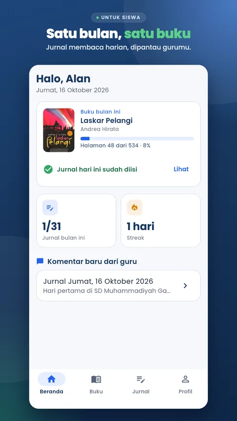
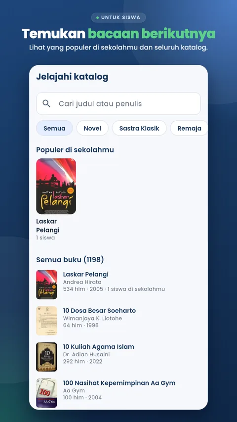
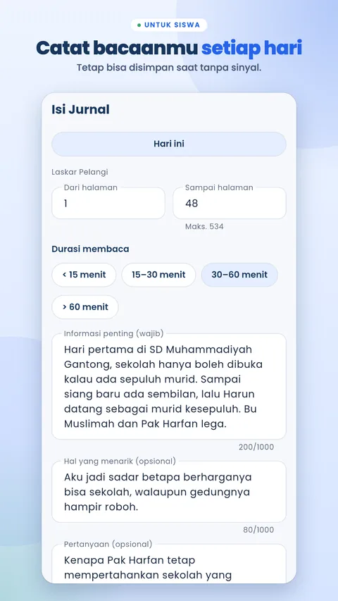
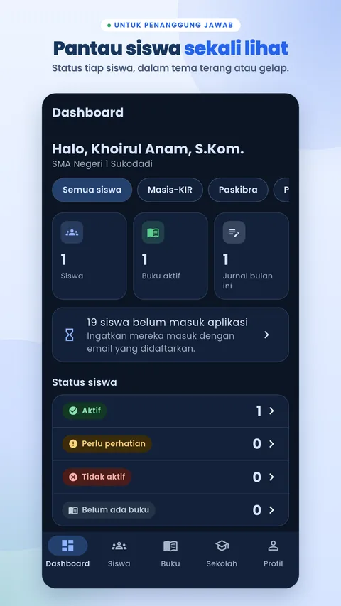

# Sabu Saku

[](https://github.com/khrlanamm/sabusaku/actions/workflows/ci.yml)


**Satu Bulan Satu Buku** (one book a month): an Android reading journal for high school students. Students read one book a month and log their reading every day. Teachers in charge (subject teachers, homeroom teachers, or club advisors) follow every student in their school, leave comments, and add students and other teachers by email. One app serves many schools. The developer registers each school and its first teacher.

[Google Play](https://play.google.com/store/apps/details?id=com.sabu.saku) | [Website](https://sabusaku.web.app) | [User guide (PDF, Indonesian)](https://sabusaku.web.app/panduan.pdf)

## Screenshots

| Student home | Catalog | Daily journal | Teacher dashboard |
|---|---|---|---|
|  |  |  |  |

## Architecture

```mermaid
flowchart LR
  app["Flutter app<br>students and teachers"]
  subgraph Firebase
    auth["Authentication<br>claims: role, schoolId"]
    fs[("Firestore<br>schools, members, journals")]
    st[(Storage)]
    call["Callables<br>claimAccount, addStudents, saveBook, ..."]
    trig["Triggers<br>progress, summaries, comments"]
    sched["Scheduled<br>dailyRefresh, teacherDigest, monthlyRecap"]
    fcm[Cloud Messaging]
  end
  app -->|email or Google| auth
  app -->|journals, offline outbox| fs
  app -->|profile photos| st
  app --> call
  call --> auth
  call --> fs
  fs --> trig
  trig -->|progress and rankings| fs
  sched --> fs
  trig -->|new comment| fcm
  sched -->|digests| fcm
  fcm --> app
```

## Sign-in

Email and password, or **Sign in with Google**, with no school code or student number. Users create their own accounts. School data opens only when the email is listed in `members/{email}` (one email, one school). The `claimAccount` callable sets the claims `{role, schoolId}`. An unregistered email sees "Harap Menghubungi Administrator Sekolah" (please contact your school administrator) with a link to [sabusaku.web.app/daftar-sekolah](https://sabusaku.web.app/daftar-sekolah). A Google account without a password, or a profile without a name or class, goes to the complete-account screen. Classes (`XII-A1`) and clubs (`Masis-KIR`) are labels on the school document.

Flutter for the app, Firebase (project `sabusaku`, region `asia-southeast2`) for the whole backend. The full specification is in [`docs/`](docs/) (Indonesian). Decisions that differ from the original design are recorded in [`docs/07`](docs/07-keputusan-dan-asumsi.md), section 0.

## Structure

```
lib/
  app/            router (one redirect for sign-in, email verification, complete account, role) and theme
  core/           models, WIB time, errors, shared widgets and repositories
  features/
    auth/         email and Google sign-in, sign-up and verification, complete account, profile,
                  session from claims
    student/      home (stats, book history), books, journal by month or calendar (with an
                  offline outbox), streak, profile
    ranking/      periods, school rankings (students and teachers), badges
    teacher/      teacher in charge: dashboard (filters for my students, class, club, active
                  books, this month's journal), students (add, import, not signed in yet),
                  comments, school (class and club labels, teachers, settings), homeroom and
                  advisor roles
    notifications/ FCM: device tokens, comment and student notifications, deep links
functions/
  src/domain/     streak, status, period, and ranking rules (pure functions)
  src/callables/  claimAccount, addStudents, removeStudent, eraseStudent, addTeacher,
                  removeTeacher, deleteMyAccount, ...
  src/triggers/   recompute student progress and summaries, comment notifications, homeroom
                  and advisor names on the school document (onTeacherWritten)
  src/scheduled/  dailyRefresh (00:10 WIB, also rankings), teacherDigest (06:30 WIB),
                  monthlyRecap (1st of the month, 07:00 WIB)
  tools/          developer scripts (see below)
  test/           domain (unit), rules, integration (emulator)
firestore.rules   security rules. Every case in docs/03 section 6 has an automated test
storage.rules     profile photos at schools/{s}/avatars/{uid}.jpg
integration_test/ end-to-end flows on an Android device
hosting/          sabusaku.web.app: about, school registration, privacy, data deletion, guide
store/            Google Play listing text and graphics
docs/manual/      PDF user guide and the script that builds it
```

## Requirements

Flutter 3.47+, Node 22+, JDK 21 (for the Firestore emulator), Firebase CLI 15+, and an Android emulator or device.

```sh
flutter pub get
(cd functions && npm ci)
```

Models and providers use code generation. After changing files annotated with `@freezed` or `@riverpod`:

```sh
dart run build_runner build
```

## Running

Everything runs directly on **production** (project `sabusaku`). There is no dev project and no demo school, so `flutter run` connects to production. To try the app, use a teacher or student account registered at a real school.

The Firebase Emulator is used only by the automated tests (`npm run test:all`, `tool/e2e.sh`). `--dart-define=USE_EMULATORS=true` points the app at the local emulator.

## Tests

| Command | Scope |
|---|---|
| `flutter analyze && flutter test` | Flutter unit and widget tests |
| `(cd functions && npm test)` | Streak, status, and WIB date rules |
| `(cd functions && npm run test:all)` | Security rules, then callables and triggers, on the emulator |
| `tool/e2e.sh` | End-to-end flows on an Android device against the emulator |

CI (GitHub Actions) runs the first three on every push.

## Developer scripts

Run them from `functions/`. Without `--emulator`, a script works on **production** with the service account in `secret/`. Only these scripts can add a school and its first teacher. Other teachers are added in the app (School tab).

| Script | Purpose |
|---|---|
| `npx tsx tools/create-school.ts --code sman1 --name "SMA Negeri 1 ..."` | Register a school with the starting club labels (Masis-KIR, Paskibra, Pala, PMR) |
| `npx tsx tools/add-guru.ts --school sman1 --email ... --name "..." [--ekskul ...] [--wali XII-A1]` | Register a teacher, optionally with clubs and a homeroom class |
| `npx tsx tools/remove-guru.ts --email ...` | Remove a teacher |
| `npx tsx tools/rebuild-rankings.ts [--school sman1] [--dry-run]` | Rebuild all rankings (`leaderboards`) from history and fill the program's `journalDates`. Run once after the ranking feature was installed. Triggers and the daily refresh keep it current after that |
| `npx tsx tools/refresh-staff.ts [--school sman1]` | Rebuild the homeroom and advisor names that students see (`schools.staff`). Triggers keep it current after that |
| `npx tsx tools/import-students.ts --school sman1 --file secret/siswa.csv` | Import students from a CSV `email,nama,kelas,ekskul` (clubs separated by `;`). Keep files with student data in `secret/` |
| `npx tsx tools/set-school-status.ts --code sman1 --status suspended` | Suspend or reactivate a school |
| `npx tsx tools/export-school.ts --code sman1` | Export all school data to `secret/exports/` |
| `npx tsx tools/delete-school.ts --code sman1 --confirm sman1` | Delete a school with its data and memberships. Cannot be undone |

## User guide

The guide for students and teachers is `docs/manual/panduan-sabu-saku.pdf`, also served at [sabusaku.web.app/panduan.pdf](https://sabusaku.web.app/panduan.pdf) (`hosting/panduan.pdf`). Rebuild both with:

```sh
python3 -I docs/manual/make_manual.py   # needs Pillow and Google Chrome
```

The text, the marker positions on each image, and the page layout are in that script. Raw screenshots (1080x2424 PNG) are taken with `tool/screenshots.sh` from production accounts (except `mulai-pilih-akun-google.png`, an ordinary device screenshot) and copied to `docs/manual/raw/`, which is not in git. The script covers every email address with `MASKS`, crops the top, and saves JPEG files to `docs/manual/shots/`. Only those JPEG files are committed. A new screenshot that shows an email, or the name or photo of a student or teacher other than the two screenshot accounts, must be added to `MASKS` first (names are replaced with made-up ones). The Google Play QR code (`docs/manual/assets/qr-play.svg`) is static. Rebuild it only if the store link changes.

## Deploy

```sh
firebase deploy --only firestore,storage --project sabusaku
tool/deploy-functions.sh                                     # Cloud Functions, in batches
firebase deploy --only hosting --project sabusaku            # website, school registration, privacy, data deletion
```

The Cloud Run CPU quota in `asia-southeast2` is only 20 vCPU for all running instances, and a deploy starts one instance per function. So functions are deployed in batches (`tool/deploy-functions.sh [name ...]`), and triggers and schedules use fractional CPU (`BACKGROUND_OPTIONS` in `functions/src/config.ts`). A trigger that fails on its first creation is left behind as an HTTPS function and must be deleted (`firebase functions:delete <name> --region asia-southeast2 --project sabusaku`) before deploying it again.

## Android release

```sh
flutter build appbundle --release
```

Release builds are signed with the upload keystore when `secret/key.properties` exists. The `secret/` folder (service account, keystore, student data for imports) is not in git, so keep your own backup.

Google sign-in needs the SHA-1 of every signing certificate on the Firebase Android app. Registered: debug, upload key, and **Play App Signing** (since 16 October 2026). If a key changes, add its SHA (`firebase apps:android:sha:create`) and download `android/app/google-services.json` again.

The listing text and Play Console answers are in `store/listing.md`. Rebuild the listing graphics with:

```sh
python3 store/make_assets.py         # output in store/out/
```

The screenshots in `store/raw/` are still from v1 (a demo school that has been deleted). Take new ones from a real school account before updating the listing.

App Check is installed but **not enabled yet**. Until Play Integrity is linked, token requests fail slowly and delay the first sign-in by about 20 seconds. The Play App Signing SHA-256 is already registered in Firebase. Remaining steps: link Play Integrity to the project, build with `--dart-define=APP_CHECK=true`, then turn on enforcement in the Firebase Console.

## License

All rights reserved. The source code is public for reference only. See [LICENSE](LICENSE).
